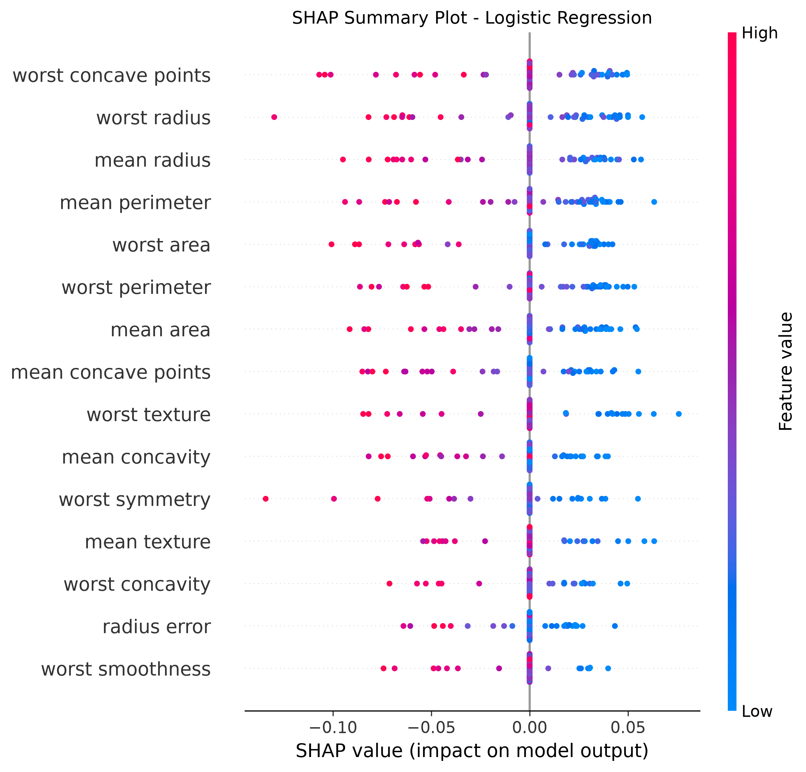

# CSC561-Project-2-NN

This project is a FP take on the CSC561 gradients project. 

In the `cMath` folder, we have our custom math implementations and tests for calculus operations and vector operations.
These form the backbone of the models.

Then in the `src` file, there is the pipeline where the models are developed. So you have optimizers, activation, functions, and loss functions. These all are used for making the ML model learn from the other points.

I decided to make this fully functional (apart from the tests) because I feel like functional programming allows more modularity and flexibility and it seemed like a new challenge.
After building a Logistic Regression model, I then utilized the SHAP library in python to generate an explainer for how the different inputs in the breastcancer dataset impact the prediction.

This is seen in the photo: `shap_summary.png` in `src` folder.

This is the Shap explainer. At 0.0 you have no effect on the model, each point shows how the model interpreted a patient. 
The colors correspond with the size of the change, and then the +/- show how it impacts the prediction. 0 was benign and 1 was malignant.